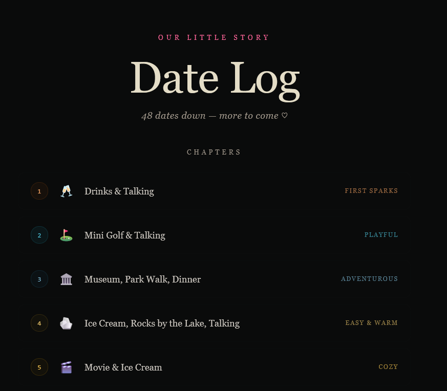
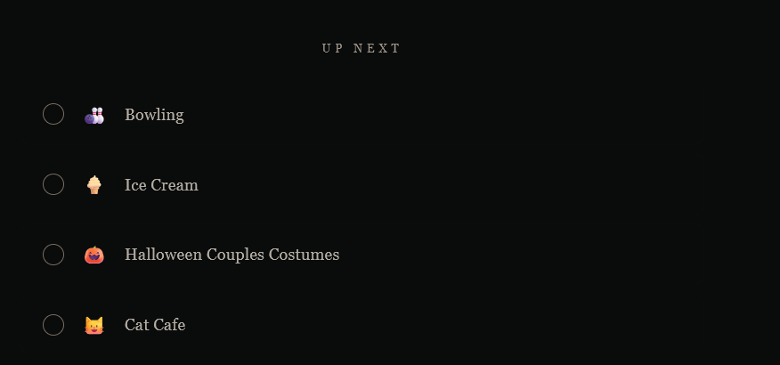

# Date Tracker

A single React component that shows a log of past dates and a checklist of ideas for future ones.

This is the original standalone version. The one I actually use now is built into [adityajain.ca](https://github.com/adityajain13/adityajain-ca) at `/dates`, with sign-in, an editor, and storage in Cloudflare KV.



## Using it

`DateTracker.jsx` has no dependencies beyond React. Copy it into a project, then create your data file next to it:

```bash
cp dates.example.js dates.js
```

`dates.js` is gitignored, so your data stays local.

```jsx
import DateTracker from "./DateTracker";

export default function App() {
  return <DateTracker />;
}
```

## Data format

```js
export const pastDates = [
  { num: 1, title: "Drinks & Talking", emoji: "🥂", vibe: "first sparks" },
  { num: "10.1", title: "Cottage: Drive Up", emoji: "🛒", vibe: "cozy" },   // multi-day trips use sub-numbers
  { num: "10.2", title: "Cottage: Kayaking", emoji: "🛶", vibe: "golden" },
];

export const futureDates = [
  { id: 1, text: "Escape Room", emoji: "🔐" },
];
```

`vibe` sets the label colour. Valid values: `first sparks`, `playful`, `adventurous`, `easy & warm`, `cozy`, `the one`, `golden`, `silly & sweet`, `spontaneous`, `creative`, `meaningful`. `the one` and `golden` get a highlight on hover.

Ticking off a future date isn't saved. It resets on refresh.


