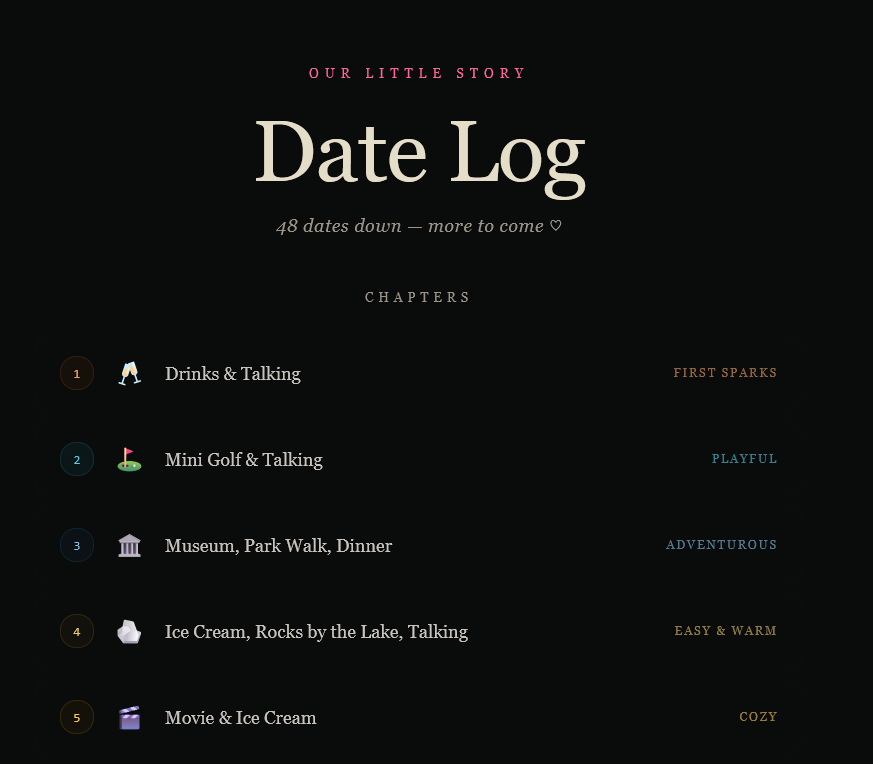
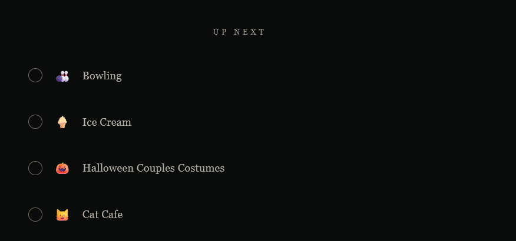

# Date Tracker 💕

A personal date log built in React — keep a running record of every date you've been on, and a wishlist of ideas for the next one.



---

## What it does

One scrolling page, two sections:

**Chapters** — every past date listed in order, each with a number, emoji, one-line description, and a vibe label coloured by mood. Milestone moments (`the one`, `golden`) glow their own accent colour on hover.

**Up Next** — a checklist of future date ideas. Click any to check it off; checked ones strike through and a running count appears at the top. Nothing persists on refresh — it's meant as a "right now" planning tool, not a to-do list.

Multi-day trips get sub-numbered entries (`1.1`, `1.2`, `1.3`) so each day gets its own line without inflating the date count.



---

## Vibe labels

Each past date gets one of these labels — styled with its own accent colour:

| Vibe | When to use it |
|---|---|
| `first sparks` | Those early, electric ones |
| `playful` | Competitive or goofy energy |
| `adventurous` | Something new, a bit of an expedition |
| `easy & warm` | Low-key, comfortable, just right |
| `cozy` | Staying in or slow days |
| `the one` | Milestone moments |
| `golden` | Full, rich days that felt complete |
| `silly & sweet` | Laughing the whole time |
| `spontaneous` | Unplanned, just happened |
| `creative` | Made something together |
| `meaningful` | Deeper conversations, real ones |

---

## Setup

### 1. Clone the repo

```bash
git clone https://github.com/adityajain13/date-tracker.git
cd date-tracker
```

### 2. Add your data

Copy the example file and fill it in:

```bash
cp dates.example.js dates.js
```

`dates.js` is listed in `.gitignore` — your personal data never touches GitHub.

**`dates.js` structure:**

```js
export const pastDates = [
  { num: 1, title: "Drinks & Talking", emoji: "🥂", vibe: "first sparks" },
  { num: 2, title: "Mini Golf", emoji: "⛳", vibe: "playful" },
  // Multi-day trips get sub-numbers:
  { num: "10.1", title: "Cottage: Drive Up → Grocery Run", emoji: "🛒", vibe: "cozy" },
  { num: "10.2", title: "Cottage: Kayaking → Beach → Bonfire", emoji: "🛶", vibe: "golden" },
];

export const futureDates = [
  { id: 1, text: "Escape Room", emoji: "🔐" },
  { id: 2, text: "Stargazing at a dark sky spot", emoji: "🌌" },
];
```

### 3. Drop it into your project

`DateTracker.jsx` is a self-contained React component. Import it wherever you need it:

```jsx
import DateTracker from "./DateTracker";

export default function App() {
  return <DateTracker />;
}
```

It expects `dates.js` to live alongside it and export `pastDates` and `futureDates`.

---

## File structure

```
date-tracker/
├── DateTracker.jsx      # The component (public)
├── dates.example.js     # Shape template (public)
├── dates.js             # Your actual data (gitignored)
├── .gitignore
└── README.md
```

---

## Keeping your data private

`.gitignore` excludes `dates.js` by name. Only the component and the example file are committed. Your dates stay on your machine.

If you want a backup, export to JSON:

```bash
node -e "
  const fs = require('fs');
  const src = fs.readFileSync('dates.js', 'utf8');
  const match = src.match(/export const pastDates = (\[[\s\S]*?\]);[\s\S]*?export const futureDates = (\[[\s\S]*?\]);/);
  const fn = new Function('const pastDates = ' + match[1] + '; const futureDates = ' + match[2] + '; return { pastDates, futureDates };');
  fs.writeFileSync('dates.json', JSON.stringify(fn(), null, 2));
  console.log('Exported to dates.json');
"
```
